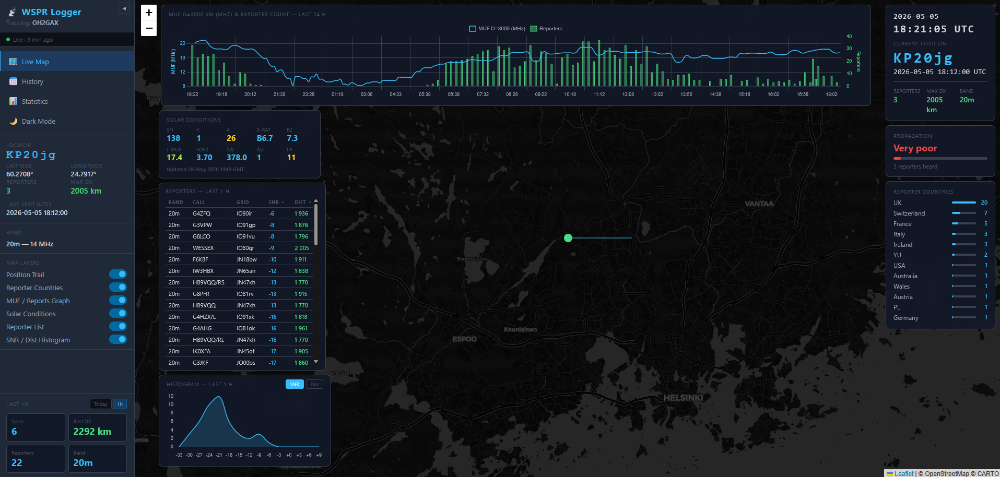

# WSPR Logger

A lightweight web-based dashboard for tracking and logging WSPR beacon transmissions in real time. Built with Python/Flask on the backend and a single-page Leaflet.js frontend, it queries [wspr.live](https://wspr.live) every 10 minutes, stores spots in a local SQLite database, and presents live position, history, statistics, propagation conditions, ionospheric MUF data, solar indices, and reporter country breakdowns in the browser.

Originally developed to track a mobile WSPR beacon (callsign **OH2GAX**) operating on the 20 m band from a car, but fully configurable for any callsign and band.

---

## Features

- **Live map** — beacon position shown as a solid colour circle; auto-centres on first spot; zoom level remembered between sessions
- **Age-aware beacon marker** — circle is **green** when the last spot is less than 1 hour old, **red** when older, giving an instant visual indication of whether the beacon is active or the band is closed
- **Live UTC clock** — date and time displayed at the top of the Current Position overlay, updated every second; date and time shown on separate lines for easy reading
- **Stale data indicators** — when the last spot is older than 1 hour the locator, last spot timestamp, Reporters, and Max DX texts turn red in both the sidebar and map overlay, the Propagation card switches to "No propagation / 0 reporters", helping users quickly assess band conditions
- **Position trail** — dashed polyline connecting today's logged positions on the live map
- **Propagation indicator** — estimates band conditions from the latest reporter count (Very poor → Extremely good) with a colour-coded bar; resets to "No propagation" automatically when data is stale
- **MUF / Reporter count graph** — optional dual-axis chart (blue line = Juliusruh ionosonde MUF D=3000 km, green bars = reporter count); data logged every 10 minutes; selectable time range — **1d / 2d / 3d / 1wk** — directly on the panel; toggle on/off from sidebar; MUF values sourced from the GIRO DIDBase MUFD endpoint (station JR055) alongside foF2, replacing the older HTML scraper
- **Solar conditions panel** — optional top-left overlay showing 10 colour-coded indices: SFI, K-index, A-index, X-ray flux, Bz (IMF), Juliusruh MUF, foF2, Solar Wind speed, Aurora activity, and Proton Flux; every field uses NOAA-standard colour thresholds (quiet = default accent, escalating through yellow-green → yellow → orange → red → purple); moves down automatically when the MUF graph is also enabled; refreshes every 60 seconds from hamqsl.com and the GIRO DIDBase; toggle on/off from sidebar
- **Reporter countries** — optional overlay listing every country that heard the beacon in the past hour, with a proportional bar and station count; loads instantly from backend cache
- **Reporter list** — optional left-side panel showing individual reporter stations from the past 60 minutes with band, callsign, grid locator, SNR, and distance; sortable by SNR or distance; scrollable list with room for ~20 entries
- **SNR / Dist histogram** — optional left-side panel showing a smooth filled line graph of reporter distribution for the past 60 minutes; toggle between SNR (dB bins) and Distance (km bins) with a tab switch; stacks below the Reporter List when both are visible
- **Reporter plot** — optional map layer that places a filled circle at each reporter's grid location and draws a **great-circle arc** from the beacon to each reporter (using spherical SLERP interpolation with 60 waypoints, correctly split at the antimeridian); line thickness and opacity scale with SNR so the strongest reporters stand out visually; click any marker for a popup showing callsign, grid, SNR, and distance; clears automatically when data goes stale
- **Day / Night overlay** — optional map layer showing the current night hemisphere as a semi-transparent dark fill with a dashed amber terminator line; computed entirely in the browser from an accurate solar position model (correct GMST formula with J2000.0 epoch offset); redraws every 60 seconds independently of the data poll cycle
- **History view** — map and table of all logged spots for any selected date
- **Statistics view** — daily and all-time records (spot count, longest DX, max reporters)
- **1 h / Today stats** — toggle the sidebar mini-stats between the last 60 minutes (default) and the full day
- **History player** — replay any stored day on the live map from the sidebar **History Player** switch: a player bar (play/pause, time slider, date picker with previous/next day, 1–16 frames per second, **Live ✕** to leave) steps through the snapshots stored every ~10 minutes. The enabled layers show the replayed moment: Reporter List, SNR / Dist Histogram, Reporter Plot arcs, Reporter Countries and the Solar Conditions panel (including foF2 and MUF); the Propagation overlay uses the spot logged at that time. Needs the replay database (`[replay] enabled = true`)
- **Propagation Analysis page** — built from the replay history: a band-open heatmap (UTC hour by date, reporters or farthest distance), a typical-day chart with today overlaid, reporters versus Juliusruh MUF, K-index and SFI (shown as an index against the typical value for the same hour, so the day/night cycle does not distort the comparison), a list of geomagnetic storm days, DX windows by hour and month, the farthest reporters with links into the History Player, a "right now" comparison with history, and an ionosonde (MUF / foF2) day view; 30 d / 90 d / All
- **WPRS page** — the car's movements from the logged 6-character locators: a drive detector lists the days on which the car moved (squares used, distance moved, path length, distance from the home square) with a distance filter, a map shows the visited squares and the track line for the chosen day(s), and a drive replay plays the fixes in order or opens a moment in the History Player
- **Guides** — sidebar entry that lists the PDF documents in the `doc/` folder (technical notes and studies about the station and its data) with *Open* and *Download* links (a tab of the same window as *What's new*); titles and descriptions come from `doc/guides.json`
- **What's new and About** — sidebar entries: *What's new* lists the last 10 days of changes straight from `CHANGELOG.md` with a version label `v.DDMMYYYY` (NEW marker until opened); *About* describes the station (operator, transmitter, antenna, home locator)
- **Remembered Map Layers** — the Map Layers switches (Position Trail, Reporter Countries, MUF graph, Solar Conditions, Reporter List, Histogram, Reporter Plot, Day / Night) and their sub-settings (MUF period, histogram SNR/Dist tab, reporter list sort, 1h / Today tab) are saved in the browser and restored on the next visit
- **Light / Dark theme** — toggle in the sidebar; preference is remembered in the browser
- **Collapsible sidebar** — fold the panel away for a full-screen map view, handy on mobile
- **Config-file driven** — all settings managed in `config.ini`; no settings UI exposed to the browser
- **SQLite storage** — one database file, WAL mode, indexed for fast date-range queries; separate table for MUF history
- **Expanded callsign→country mapping** — 350+ prefix entries covering all of Europe (including full Balkans: 9A, S5, YU, E7, Z3, 4O, ZA, Z6), complete German D* series, UK Foundation/Intermediate calls (2E/2M/2W/2I), French TM special events, Caucasus, Central Asia, and more; raw prefix shown as fallback for truly unknown callsigns; non-standard station identifiers that contain no digit (e.g. monitoring beacons such as WESSEX) are automatically identified by their grid locator instead of the callsign prefix, preventing misclassification

---

## Screenshots


*Live map (dark mode) with all panels enabled: MUF D=3000 km / Reporter Count graph spanning the top, Solar Conditions, Reporter List, and SNR / Dist Histogram stacked on the left, Current Position / Propagation / Reporter Countries overlays on the right, Reporter Plot layer showing SNR-weighted great-circle arcs from the beacon to each reporter, Day/Night overlay with dashed terminator line, and the collapsible info sidebar on the left.*

---

## How It Works

1. A background thread polls **wspr.live** (a public ClickHouse database) at minutes `:08`, `:18`, `:28`, `:38`, `:48`, `:58` — six minutes after each 10-minute WSPR transmission cycle, giving reporters time to upload their data.
2. One query looks at the last 45 minutes (up to 5 transmission slots), groups the received spots by `(tx_loc, time)` and returns the Maidenhead locator, UTC timestamp, reporter count, and maximum reported distance for each slot. Re-reading recent slots matters because distant reporters (USA, Asia, Pacific) upload to wspr.live several minutes after the nearby ones.
3. New slots are inserted into the local SQLite database. Slots that are already stored are *updated* when a later poll reports more reporters or a longer distance (the larger value always wins and values are never lowered), so late-arriving DX is captured and **Best DX** stays correct.
4. At each poll cycle the backend fetches the **MUF D=3000 km** (MUFD) from the [GIRO DIDBase](https://lgdc.uml.edu/) (station JR055, Juliusruh; the Juliusruh monitor page is the fallback) using the `DIDBGetValues` API with a 24-hour rolling window and the `YYYY/MM/DD HH:MM:SS` date format required by the endpoint (~5 minute data lag). The GIRO parser requires a decimal point in the value token to avoid misreading integer quality-score fields. MUF is stored in the `muf_data` table; **foF2** is read first from the Juliusruh Space Weather Monitor page (`ionosonde.iap-kborn.de`, "ION" row, updated every 15 min) and only if that fails from GIRO; it is cached in memory and served via `/api/solar`.
5. Reporter country data is derived from individual reporter callsigns, cached in memory, and bundled into every `/api/latest` response — no extra wspr.live queries are ever triggered from the browser.
6. Individual reporter details (callsign, grid, SNR, distance) are also fetched and cached at each poll cycle, available via `/api/reporter_list` for the Reporter List panel.
7. On startup the background thread performs an immediate fetch of the latest spot, reporter countries, reporter list, and MUF value so the UI has data ready the moment the page is opened.
8. The browser polls `/api/latest` every 60 seconds and updates the map, overlays, and sidebar without a page reload.
9. **Solar conditions** are fetched on demand from [hamqsl.com](https://www.hamqsl.com/solarxml.php) with a 60-second server-side cache; the frontend polls `/api/solar` every 60 seconds when the panel is visible. Solar data is also fetched in the background poll thread to ensure it is stored even when no browser has the panel open.
10. At every poll cycle the backend writes a historical snapshot to a separate **replay database** (`wspr_replay.db`) — individual reporter records (callsign, grid, SNR, distance) and a full solar/geomagnetic conditions row (SFI, K, A, X-ray, Bz, solar wind, aurora, proton flux, foF2, MUF). This database feeds the History Player and grows at roughly 50–80 MB per year.

---

## Requirements

| Component | Version |
|-----------|---------|
| Python    | 3.9 or newer |
| Flask     | 3.0 or newer |
| SQLite    | bundled with Python |

No other Python packages are required. The frontend loads Leaflet.js and Chart.js from CDN and needs no build step.

---

## Installation on Ubuntu

### 1 — Clone or copy the files

```bash
git clone https://github.com/your-username/wspr_logger.git
cd wspr_logger
```

Or copy the project folder to your preferred location, for example `/opt/wspr_logger`.

### 2 — Install Python dependencies

```bash
sudo apt update
sudo apt install python3 python3-pip python3-venv -y
```

Create a virtual environment (recommended):

```bash
python3 -m venv venv
source venv/bin/activate
pip install flask
```

### 3 — Add your CARTO Basemaps API key

The dark/light map tiles are served by [CARTO Basemaps](https://carto.com/basemaps/apikey/), which now requires a free API key — without one the map shows an "API key required" watermark. Copy the template and fill in your key:

```bash
cp api_keys.py.example api_keys.py
```

Edit `api_keys.py`:

```python
CARTO_API_KEY = "your-carto-key-here"
```

`api_keys.py` is listed in `.gitignore` and is never committed — this keeps your key out of the public repository while letting you develop and push freely. If the file is missing entirely, the server still starts; it just prints a console warning and the map shows the watermark until the key is added. Request a key at [carto.com/basemaps/apikey](https://carto.com/basemaps/apikey/) if you don't already have one — it's free for up to 5,000,000 tile requests per month.

### 4 — Edit the configuration file

Open `config.ini` and set your callsign, preferred band, and server address:

```ini
[station]
callsign = OH2GAX
default_band = 14        ; MHz — 14 = 20 m

[server]
host = 0.0.0.0           ; listen on all interfaces
port = 5008
debug = false

[database]
path = wspr_data.db      ; relative to the script directory

[map]
default_lat = 60.0
default_lon = 24.0
default_zoom = 6
```

### 5 — Test the server manually

```bash
source venv/bin/activate   # if not already active
python3 wspr_logger.py
```

Open `http://<server-ip>:5008` in a browser. You should see the dashboard. The first spot will appear at the next polling window (minutes ending in 8).

Press `Ctrl+C` to stop.

---

## Running Manually in the Background

If you prefer to run the logger without setting up a systemd service, you can launch it as a background process using `nohup`:

### 1 — Start the server

```bash
cd wspr_logger
python3 -m venv venv
source venv/bin/activate
sudo nohup python3 wspr_logger.py > /dev/null 2>&1 &
```

The process detaches from the terminal immediately. Output is discarded (`/dev/null`); if you want to keep a log file instead, replace `/dev/null` with a path such as `wspr_logger.log`.

### 2 — Find the process ID

```bash
ps -ef | grep wspr_logger.py
```

Note the PID in the second column of the matching line.

### 3 — Stop the server

```bash
sudo kill <process id>
```

> **Note:** This method does not survive reboots. For a permanent installation that starts automatically, use the systemd service described in the next section.

---

## Running as a Background Service (systemd)

The recommended way to keep the logger running permanently and have it restart automatically after reboots or crashes.

### 1 — Create the service file

```bash
sudo nano /etc/systemd/system/wspr_logger.service
```

Paste the following, adjusting the paths and username to match your setup:

```ini
[Unit]
Description=WSPR Logger — beacon tracking web dashboard
After=network-online.target
Wants=network-online.target

[Service]
Type=simple
User=ubuntu                          ; change to your Linux username
WorkingDirectory=/opt/wspr_logger    ; change to your installation path
ExecStart=/opt/wspr_logger/venv/bin/python3 wspr_logger.py
Restart=on-failure
RestartSec=10

[Install]
WantedBy=multi-user.target
```

### 2 — Enable and start the service

```bash
sudo systemctl daemon-reload
sudo systemctl enable wspr_logger
sudo systemctl start wspr_logger
```

### 3 — Check the status

```bash
sudo systemctl status wspr_logger
```

### 4 — View live logs

```bash
sudo journalctl -u wspr_logger -f
```

### 5 — Restart after a config change

```bash
sudo systemctl restart wspr_logger
```

---

## Updating on a Server

`update.sh` (in the repository root) brings a git-clone installation up to date with GitHub, restarts the service, and checks that the web page answers again:

```bash
bash ~/wspr_logger/update.sh
```

It first shows the new commits and changed files and asks `Update to <hash>? [y/N]`. After you answer `y` it:

1. copies both SQLite databases to `<install folder>_backups/pre_update_<timestamp>/` using SQLite's online backup (safe while the service is running; the 7 newest copies are kept);
2. syntax-checks every changed `.py` file and template straight from git **before touching anything** — if one fails, nothing is changed and the old version keeps running;
3. fast-forwards the checkout (`git merge --ff-only`);
4. runs `pip install -r requirements.txt` only if that file changed;
5. restarts the service and waits (up to 40 s) until the web page returns HTTP 200.

| Option | Description |
|--------|-------------|
| `-y`, `--yes` | Do not ask for confirmation |
| `--rollback` | Return to the version that was running before the last update and restart |
| `-h`, `--help` | Show usage |

**Local changes are never overwritten.** Files that differ on the server — typically `config.ini` (for example `host = 127.0.0.1` behind an nginx reverse proxy), `api_keys.py`, and the databases — stay as they are, and the script never runs `git reset`, `git stash`, or `git checkout`. If GitHub changes a file that is *also* modified locally, the script stops without changing anything and explains how to proceed. Because `wspr_data.db` is tracked by git as an empty placeholder, avoid committing a populated database from your development machine — the script would refuse to update rather than overwrite the live data on the server.

**Requirements:** the install must be a `git clone` with a `venv/` folder next to `wspr_logger.py`, and the user must be allowed to run `sudo systemctl restart`. The service name defaults to `wspr-logger`; if your unit is named differently, for example `wspr_logger` as in the example above, set it for the run:

```bash
SERVICE=wspr_logger bash update.sh
```

`VERIFY_SECONDS=60` extends the time the script waits for the page after a restart. If the script finds no `api_keys.py`, it warns on every run, because the map would show the CARTO watermark.

Run it as `bash update.sh` and do not `chmod +x` it — git would count the changed file mode as a local edit and block a later update of `update.sh` itself.

### Converting an existing copy into a git checkout

If the folder was created by copying files (for example from another server) instead of `git clone`, `update.sh` stops with *"is not a git checkout"*. You can attach the folder to the repository without touching your local files: `git reset` without `--hard` only moves git's bookkeeping, so `config.ini`, `api_keys.py`, the databases and `venv/` stay exactly as they are.

```bash
cd ~/wspr_logger
git status 2>&1 | head -1      # expect: fatal: not a git repository
mkdir -p ~/wspr_pre_git && cp -a config.ini api_keys.py wspr_logger.py db.py replay_db.py requirements.txt templates ~/wspr_pre_git/   # small safety copy
git init -q -b main
git remote add origin https://github.com/oh2gax/wspr_logger.git      # or your own fork
git fetch -q origin
git reset -q origin/main
git branch --set-upstream-to=origin/main main
git status --short             # D = files that were never copied, M = your local edits
```

Then restore the missing files from GitHub, skipping the two files that hold local changes (`config.ini` and the live `wspr_data.db` — never run `git checkout` on those):

```bash
git ls-files -m -d | sort -u | grep -vx -e config.ini -e wspr_data.db | xargs -r git checkout --
git status --short             # now only config.ini and wspr_data.db are listed as modified
bash update.sh                 # should report "already up to date"
```

The second command replaces every other tracked file with GitHub's version, so if you had edited code inside the copy, keep the safety copy in `~/wspr_pre_git`. Because the checkout now equals GitHub, `update.sh` will not restart the service; if the copied code was older than GitHub's, restart it once yourself with `sudo systemctl restart wspr-logger`.

---

## Firewall

If the server has `ufw` enabled, allow the port:

```bash
sudo ufw allow 5008/tcp
```

---

## Frontend User Guide

### Sidebar

| Element | Description |
|---------|-------------|
| **◀ / ▶ button** | Collapse or expand the sidebar to give the map more space |
| **Status dot** | Green = live data (< 20 min old) · Amber = stale · Red = no recent data |
| **Locator** | Current 6-character Maidenhead grid square; turns red when last spot is older than 1 hour |
| **Latitude / Longitude** | Decimal coordinates derived from the locator |
| **Reporters / Max DX** | How many stations received the last transmission and the farthest one; turn red when data is stale |
| **Last Spot (UTC)** | Timestamp of the most recent logged transmission |
| **Position Trail** | Toggle the dashed trail connecting today's positions on the live map |
| **Reporter Countries** | Toggle the country breakdown overlay on the live map |
| **MUF / Reports Graph** | Toggle the MUF and reporter count chart at the top of the map; use the 1d / 2d / 3d / 1wk buttons on the panel to change the time range |
| **Solar Conditions** | Toggle the solar indices panel on the left side of the map |
| **Reporter List** | Toggle the individual reporter table on the left side of the map |
| **SNR / Dist Histogram** | Toggle the reporter distribution line chart on the left side of the map |
| **Reporter Plot** | Toggle the map layer that plots reporter locations and draws SNR-weighted great-circle arcs from the beacon to each reporter |
| **Day / Night** | Toggle the day/night overlay showing the current night hemisphere and terminator line; updates every 60 seconds |
| **History Player** | Open the replay bar at the bottom of the map and step through stored days; the other layer switches decide which panels show the replayed data. Not remembered between visits — the page always starts live |
| **1h / Today tabs** | Switch the mini-stats cards between the last 60 minutes (default) and the full day |

*The Map Layers switches above and the 1h / Today tab, MUF period, histogram tab and reporter-list sort are remembered per browser (stored in `localStorage` under `wspr_layers`). Each browser or device keeps its own settings; clearing the site data resets them to the defaults (only Position Trail on).*
| **🌙 / ☀️ Dark / Light Mode** | Toggle the colour theme; saved across sessions |

### Live Map

The main view opens by default. The beacon position is shown as a **solid circle** — **green** when the last spot is less than 1 hour old, **red** when older. The map auto-pans to the beacon on first load. A **dashed polyline** shows today's path. Click the circle to see a popup with full spot details.

Up to **nine overlay elements** can be shown simultaneously:

**Current Position** (top-right) — live UTC date and time clock (updated every second) at the top, followed by the 6-character Maidenhead locator, last spot timestamp, reporter count, max DX, and band. The locator, timestamp, reporter count, max DX, and band values all turn red when the last spot is older than 1 hour, reverting to their normal colours when fresh data arrives.

**Propagation** (top-right, below position) — estimated band condition with a colour-coded label and fill bar:

| Reporters | Condition |
|-----------|-----------|
| ≤ 5       | Very low |
| ≤ 10      | Low |
| ≤ 20      | Normal |
| ≤ 40      | Good |
| ≤ 60      | Very good |
| ≤ 100     | Extremely good |
| > 100     | Exceptional |

If 2 or more of the current reporters are beyond 6000 km, **& DX** is appended to the condition text at any level (e.g. *Poor & DX*, *Good & DX*, *Exceptional & DX*) and the reporter sub-line shows how many were over 6000 km. The colour stays the same as the base level.

When the last spot is older than 1 hour the card shows **No propagation** with a red bar and 0 reporters, regardless of the last recorded value. On the 20 m band during daytime hours (06:00–15:00 UTC), when silence is unusual enough to suggest a transmitter problem, the message changes to **No propagation or TX Fail** as an early warning that the beacon may have stopped transmitting.

When wspr.live is unreachable — for example during a database outage or a network connectivity issue — the card shows **DB Timeout!** in amber with a *wspr.live unreachable* subtitle. This distinguishes an external data source problem from genuine propagation failure or a transmitter fault. The indicator clears automatically as soon as the next successful query to wspr.live completes.

When the Juliusruh ionosonde MUF D=3000 km exceeds 28 MHz, a **⚡ HIGH MUF** label appears in purple above the condition text, indicating enhanced propagation conditions regardless of the current reporter count.

**Reporter Countries** (top-right, below propagation) *(optional)* — unique countries from the past 60 minutes, sorted by station count, with proportional bars. Loads instantly from the backend cache; refreshes every 10 minutes with the poll cycle.

**MUF / Reports Graph** (top of map, spanning full width) *(optional)* — dual-axis Chart.js chart. The **blue line** shows the Juliusruh ionosonde MUF D=3000 km (left axis, MHz); the **green bars** show reporter count per transmission (right axis). Both datasets are logged every 10 minutes and stored in the database. Use the **1d / 2d / 3d / 1wk** buttons in the panel header to switch the time range; multi-day views label the x-axis as `Mon 14:30` so you can tell days apart at a glance. Useful for correlating band openings with ionospheric conditions over longer periods.

**Solar Conditions** (top-left, below the MUF graph when that is also enabled) *(optional)* — compact panel showing current solar and geomagnetic indices:

| Field | Description |
|-------|-------------|
| SFI   | Solar Flux Index |
| K     | K-index (geomagnetic activity, 0–9); green at 0–1 (very quiet), orange at 4–5, red at 6+ |
| A     | A-index (daily geomagnetic activity, 0–400, NOAA scale); yellow-green 8–15, yellow 16–29, orange 30–49, red 50–99, purple 100+ |
| X-ray | X-ray flux class (e.g. B9.3, C2.1); yellow for C-class, orange for M-class, red for X-class |
| Bz    | Interplanetary magnetic field Z-component (nT); diverging scale: green to purple as value goes negative, default accent for northward (≥ 0) |
| J-MUF | Juliusruh ionosonde MUF D=3000 km (MHz); colour tied to band openings: gray < 8, default accent 8–12, green 12–15, lime 15–18, yellow-green 18–22, yellow 22–25, orange 25–30, red 30–35, purple > 35 |
| foF2  | F2-layer critical frequency from Juliusruh (JR055), read from the [Juliusruh monitor page](https://www.ionosonde.iap-kborn.de/actuellz.htm) with [GIRO DIDBase](https://lgdc.uml.edu/) as backup (MHz); displayed in the default accent colour |
| SW    | Solar wind speed (km/s); default accent below 450, then yellow-green, yellow, orange, red, purple as speed increases |
| AU    | Aurora activity (0–9 Kp-like scale); lime at 3, yellow at 4, orange at 5, red-orange at 6, red at 7–8, purple at 9 |
| PF    | Proton flux (pfu, NOAA S-scale); default accent below 50 pfu, yellow ≥ 50, orange S2 (≥ 100), red S3 (≥ 1000), dark-red S4 (≥ 10000), purple S5 (≥ 100000) |

All colour thresholds follow standard NOAA / space weather classifications or practical amateur radio conventions. Default accent colour is used for quiet / background conditions in every field. Solar and geomagnetic data sourced from [hamqsl.com](https://www.hamqsl.com/solarxml.php); foF2 sourced from the Juliusruh monitor page (GIRO DIDBase as backup); both refreshed every 60 seconds while the panel is visible.

**Reporter List** (left side, below Solar Conditions when visible) *(optional)* — scrollable table of individual stations that received the beacon in the past 60 minutes, one row per unique reporter:

| Column | Description |
|--------|-------------|
| Band   | Active band (e.g. 20m) |
| Call   | Reporter callsign |
| Grid   | Reporter 6-character Maidenhead locator |
| SNR    | Best signal-to-noise ratio reported (dB); highlighted in accent colour |
| Dist   | Distance from beacon to reporter (km); highlighted in green |

Click the **SNR** or **Dist** column header to re-sort the list. The panel stacks automatically below Solar Conditions (or below the MUF graph if Solar is hidden, or at the top-left if neither is active). Refreshes every 60 seconds alongside the main poll cycle.

**SNR / Dist Histogram** (left side, below Reporter List when visible) *(optional)* — smooth filled line chart showing the distribution of reporters across SNR or distance bins for the past 60 minutes. Use the **SNR** / **Dist** tab buttons to switch modes. SNR mode bins reporters in 3 dB steps from −33 to +9 dB; Distance mode bins in 500 km or 1000 km steps depending on the furthest reporter. Data is derived from the cached reporter list — no extra server query needed. Stacks in the same left-side chain as Solar Conditions and Reporter List.

**Reporter Plot** *(optional)* — Leaflet map layer that plots a filled circle at each reporter's decoded Maidenhead grid position and draws a **great-circle arc** from the beacon's current location to every reporter heard in the past 60 minutes. Arcs are computed using spherical SLERP interpolation (60 waypoints) and are correctly split at the antimeridian so no lines streak across the map. Both the line weight (1–3.5 px) and opacity (0.18–0.90) scale with SNR, so the strongest reporters are immediately visible as thick bright lines while weak stations appear as faint thin ones. Click any reporter circle to open a popup showing callsign, grid locator, SNR, and distance. The layer clears automatically when the last spot is older than 1 hour, consistent with all other live panels. Can be enabled independently of the Reporter List panel.

**Day / Night** *(optional)* — Leaflet map layer showing the current night hemisphere as a semi-transparent dark blue fill, with a single dashed amber line marking the solar terminator. The solar position is calculated in the browser using a low-precision but accurate astronomical model (correct Greenwich Mean Sidereal Time with J2000.0 epoch offset); the terminator latitude at each longitude is derived analytically from the solar declination. The overlay redraws every 60 seconds entirely in JavaScript — no server requests are made. Toggle from the sidebar.

### History View

Select a date using the date picker or the **Today / Yesterday / −7 days** quick buttons. The map plots the full day's trail (green = first spot, blue = last spot, grey = intermediate), and the table on the right lists every transmission with time, locator, reporter count, and max DX.

### Statistics View

Shows the selected day at a glance — total spots, max and average reporters, longest DX (with its percentage of the all-time record), first and last spot time — with previous/next-day arrows. Two charts follow: *Through the day* (reporters per transmission and farthest distance) and *Best DX per day* (30 d / 90 d / All; click a bar to open that day). Below are the **all-time records**, each with the date it was set, and a clickable list of all dates with logged data.

### Analysis View

Needs the replay database. The **band-open heatmap** shows for every UTC hour and date how many stations heard you (or the farthest distance) — switch with the Reporters / Farthest km buttons and hover for details. **Typical day** shows the median and 25–75 % range of stations heard per UTC hour with the latest day drawn over it. The three **space weather** charts compare your reporter count with the Juliusruh MUF, the K-index and the solar flux: bars are an index where 100 means "as many reporters as usual at that hour", the line is the share of snapshots with a reporter beyond 6000 km. The **storm days** table lists days when K reached 5 or more and how your reporters compared with a typical day. **Right now** (top) compares the live number of stations heard with what is usual for this UTC hour and for a similar MUF. **DX windows** show when reporters beyond 6000 km are most likely, by hour of day and by month. **Farthest reporters** lists the ten longest distances of the period, and the ▶ buttons there and in the storm table open that moment in the History Player. The **Ionosonde day view** plots Juliusruh MUF (and foF2 on days where it was collected) over the stations heard for any chosen day. The **DX outlook** card gives, for the next 12 hours, the chance of a report beyond 6000 km: the history of that hour of the day, adjusted for the present MUF and K-index only if a back-test showed the adjustment helps (the card states the result). It is a description of this station's own history, not a physical forecast, and always uses the whole history. The **Grey line** card tests whether far reports cluster around sunrise or sunset at the far end or at home, with the hour of the day held fixed. Reporters whose distance contradicts their own locator by more than 500 km are excluded from the analysis and the records and listed under **Excluded reports**. Choose 30 days, 90 days or all history; results are computed from the local replay database and cached for 10 minutes (the "Right now" card is always live).

### WPRS

The **WPRS** page (Whisper Position Reporting System) turns the logged spots into a track of the car. The **left list** has one row per UTC day: the number of squares and fixes, *moved* (the largest distance between two squares used that day), the path length and, in amber, how far from the home square the car got (the home square is the most frequent locator; this also catches days parked far from home). Choose the minimum movement or distance (any change of square, 5, 10, 25, 100 km; default 10 km — an ordinary commute between neighbouring squares is 4.6–6.5 km) and how many days to show from the selected day (1, 2, 3 or 5). The **map** shows the squares visited (darker = more fixes), the track line with one dot per fix (hover for time, locator, reporters and best DX), the start (green), end (red) and home square (red ring). The **drive replay bar** at the bottom plays the fixes in order (1–16 fixes per second) with the trail so far in amber; the slider scrubs, ⏮ goes back to the start, and **History Player** opens the shown moment in the History Player on the live map (needs the replay database). The resolution is one Maidenhead subsquare, about 4.6 × 4.6 km at this latitude, and a fix exists only for transmissions that some station heard.

The **Days / Trips** switch lists consecutive days away from home as trips (dates, duration, squares, path length, farthest point); selecting a trip draws and replays it. **Copy link** gives an address that opens the same day and fix. On the live map the car's tooltip shows the age of the latest fix, and the History / reporter list, histogram and country panels can be dragged by their titles (double-click the title to reset).

### Backfilling earlier seasons

The replay database starts when the logger was first run with replay enabled. Earlier snapshots can be rebuilt from wspr.live, which keeps every spot: `tools/backfill.py` fetches the spots of the station callsign and rebuilds what each 10-minute poll at :08 would have listed (stations heard in the preceding 60 minutes). Run it on the server that holds the databases, with the project's virtual environment (`venv/bin/python`, as the service uses; plain `python3` fails with *No module named 'flask'*):

```bash
venv/bin/python tools/backfill.py --test 2025-07-15              # one day, writes nothing
venv/bin/python tools/backfill.py --from 2025-05-01 --to 2025-09-30  # week by week, with pauses
```

Options: `--callsign`, `--band`, `--chunk-days` (7), `--pause` (5 s), `--timeout` (300 s), `--yes` (no confirmation). `--to` defaults to the day before the oldest existing snapshot. Existing snapshots are never overwritten, so the command can be repeated after an interruption. Solar and MUF values are not backfilled, so old seasons appear in the heatmaps and DX statistics but not in the space-weather charts. Expect about 100 MB of database growth per season, and `update.sh` backs up both databases.

### Guides

*Guides* and *What's new* (sidebar) open one window with two tabs, *What's new* and *User guides*, each entry on its own tab. The *User guides* tab lists the PDF files in the `doc/` folder. To add a document, copy the PDF into `doc/` and, optionally, add an entry (`file`, `title`, `description`, `date`) to `doc/guides.json`; a PDF without an entry is still listed with a title made from its file name. Only plain `*.pdf` names inside `doc/` are served (`/doc/<file>`); the LaTeX sources and figure scripts of the two bundled papers are in `doc/src/` and are not served.

### What's new and About

*What's new* (sidebar) shows the changes of the last 10 days. It is generated from `CHANGELOG.md`: the bold title of each bullet is listed, grouped by date and Added / Changed / Fixed, and the version label `v.DDMMYYYY` comes from the date of the newest entry. Keep every changelog bullet starting with a bold title so it shows up. *About* shows the station information.

### Configuration

All settings are managed directly in `config.ini` on the server — there is no settings UI in the browser. This keeps the public-facing interface read-only. Edit the file and restart the service to apply any changes:

```ini
[station]
callsign = OH2GAX
default_band = 14        ; MHz — 3/7/10/14/18/21/24/28

[server]
host = 0.0.0.0
port = 5008
debug = false

[database]
path = wspr_data.db

[map]
default_lat = 60.0
default_lon = 24.0
default_zoom = 6

[replay]
enabled = true           ; set false to disable replay data collection
path = wspr_replay.db    ; separate file — safe to delete to reclaim space
```

---

## Project Structure

```
wspr_logger/
├── config.ini              — station, server, map, database, and replay settings
├── api_keys.py             — local API keys (CARTO, …); gitignored, never committed
├── api_keys.py.example     — template for api_keys.py; safe to commit
├── wspr_logger.py          — Flask app, background polling thread, REST API
├── db.py                   — SQLite read/write layer (live operational data)
├── replay_db.py            — SQLite read/write layer (replay history database)
├── analysis.py             — propagation analysis computed from the replay database
├── changelog.py            — reads CHANGELOG.md for the What's new window
├── guides.py               — lists the PDF documents in doc/ for the Guides window
├── wprs.py                 — drive detector, trips and track building for the WPRS page
├── sun.py                  — solar elevation and sunrise / sunset
├── greyline.py             — grey-line test for the Analysis page
├── outlook.py              — DX outlook model and its back-test
├── tools/backfill.py       — fills the replay database from wspr.live history
├── requirements.txt        — Python dependencies (flask)
├── update.sh               — server update: pull from GitHub, back up databases, restart, verify
├── wspr_data.db            — main SQLite database (created automatically on first run)
├── wspr_replay.db          — replay SQLite database (created automatically, safe to delete)
├── doc/                    — PDF guides shown under Guides (guides.json = titles and descriptions)
│   └── src/                — LaTeX sources and analysis scripts of those PDFs (not served)
├── tmp_files/              — scratch folder, gitignored
└── templates/
    └── index.html          — single-page frontend (Leaflet.js, Chart.js, vanilla JS)
```

---

## REST API

| Endpoint | Method | Parameters | Description |
|----------|--------|------------|-------------|
| `/api/latest` | GET | `band` | Most recent spot, cached reporter countries, and `wspr_down` flag indicating whether wspr.live is currently reachable |
| `/api/positions` | GET | `date`, or `from`+`to`, `band` | List of spots for a date or time range |
| `/api/stats` | GET | `date`, `band` | Aggregated stats for a date, all-time records and the list of logged dates |
| `/api/analysis` | GET | `days` (0 = all, default 90), `band` | Heatmap, typical-day profile, MUF / K / SFI bins, storm days, excluded reports, grey-line test and DX outlook computed from the replay database; cached 10 min |
| `/api/daily_summary` | GET | `band` | Per-day totals (transmissions, best DX, max reporters) for the Statistics chart |
| `/api/whatsnew` | GET | — | Version label and the last 10 days of changes parsed from `CHANGELOG.md` |
| `/api/wprs/days` | GET | `band` | Home square, one movement summary per logged UTC day (squares, moved, path, distance from home) and the trips |
| `/api/wprs/track` | GET | `from`, `to` (YYYY-MM-DD, up to 7 days), `band` | Fixes, visited squares and statistics for those days |
| `/api/guides` | GET | — | The PDF documents in `doc/` (file, title, description, date, size) |
| `/doc/<file>` | GET | — | One PDF from `doc/` (`application/pdf`; only plain `*.pdf` names) |
| `/api/replay/dates` | GET | `band` | `{enabled, dates}` — UTC dates that have replay snapshots, newest first |
| `/api/replay/day` | GET | `date` (YYYY-MM-DD), `band` | All replay frames of one day: reporters, country counts and solar indices per snapshot (~300 KB for a full day) |
| `/api/reporters` | GET | — | Cached reporter countries from the past 60 minutes |
| `/api/reporter_list` | GET | — | Cached individual reporter details (callsign, grid, SNR, distance) from the past 60 minutes |
| `/api/muf` | GET | `band` | MUF D=3000 km readings and reporter counts for the last 24 hours |
| `/api/solar` | GET | — | Current solar indices (SFI, K, A, X-ray, Bz, J-MUF, foF2, SW, AU, PF); cached 60 s |

---

## License

This project is released under the MIT License — you're free to use, copy, modify, distribute, and reuse the code, including in commercial projects, as long as the original copyright notice and the license text are included with substantial portions of the code. The full license text is in the `LICENSE` file at the repository root.

If you build something interesting on top of it, a quick note (or a star on the repo) is appreciated but not required. 73 — Otso, OH2GAX.
